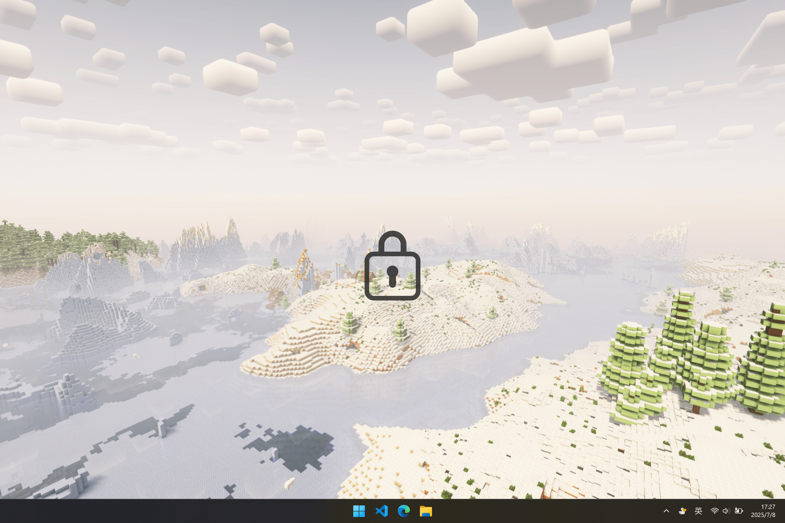
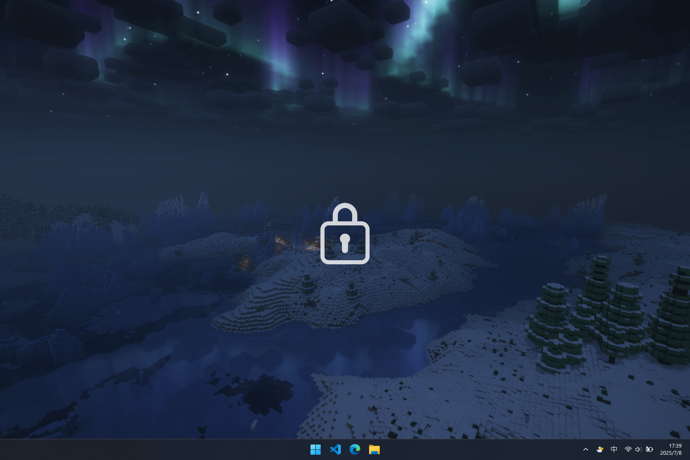
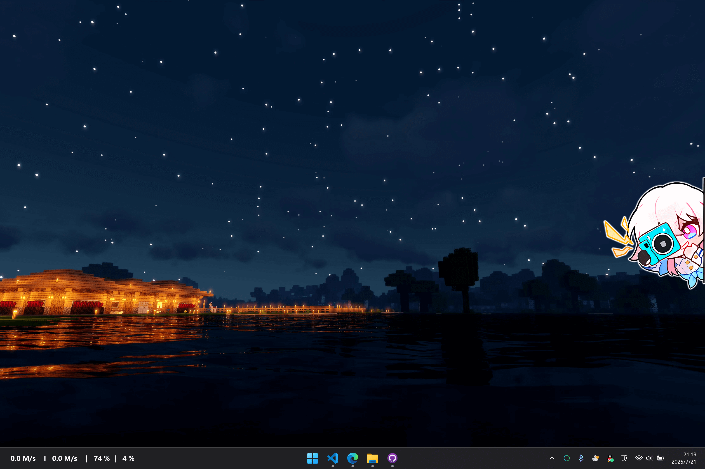

# CapsGlow
 
A lightweight Caps Lock indicator for Windows, supporting theme switching, monitor selection (mouse or primary), and flexible positioning. 🦆

一款适用于 Windows 的轻量级 Caps Lock 状态指示器，支持主题切换、显示器选择（主显示器或鼠标所在显示器）及灵活的位置设置。 🦆

## ☀️ Light Theme / 亮色主题

## 🌙 Dark Theme / 暗色主题

## 🎨 Customize / 自定义图标

## Contributing / 贡献

Contributions are welcome! Please feel free to submit a Pull Request.

欢迎合并提交来贡献！

## Features / 功能
- **开机自启动   
   Launch at Startup**

- **指示器主题：跟随指示器区域（默认） / 跟随系统  
   Theme Mode: Indicator Area (default) / System**

- **显示所在的监视器：鼠标下的监视器（默认） / 主监视器  
    Monitor Selection: Under Mouse (default) / Primary Monitor**

- **指示器窗口位置：居中显示（默认）  
    Indicator Window Position: Center (default)**
---
- **自定义指示器图标  
        Customize Indicator Icon**  
        1. 在软件目录中放入指定名称的PNG图标   
                Place the specified icon in the software directory   
        2. 默认图标 / Default icon: `capslock.png`  
        3. 主题图标 / Theme icon: `capslock-dark.png` + `capslock-light.png`

---
- **以管理员权限启动时，窗口置顶优先级更高（可覆盖开始菜单）   
   Higher Always-on-Top Priority When Run as Administrator**
